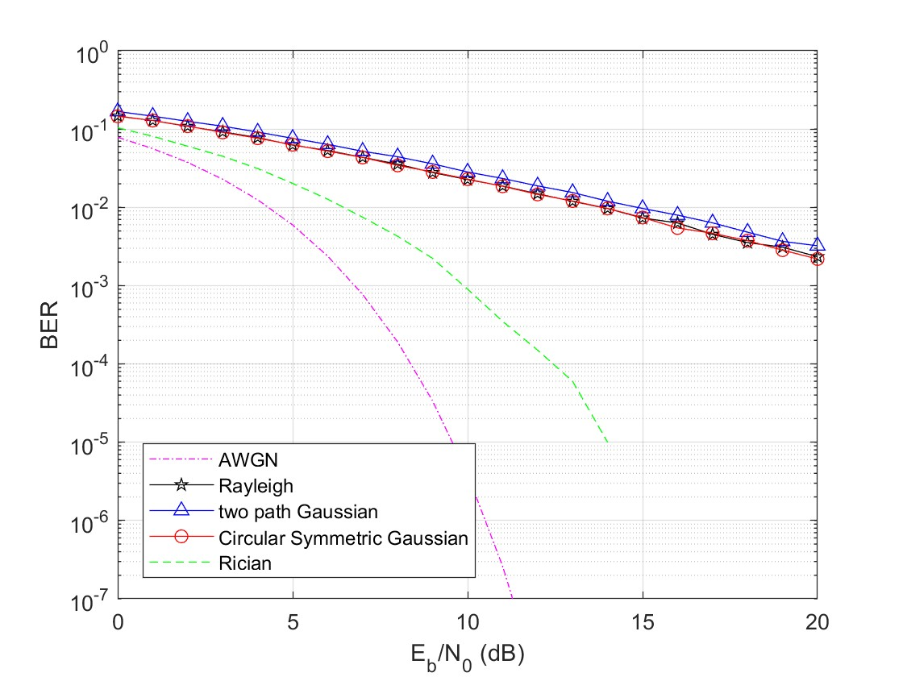
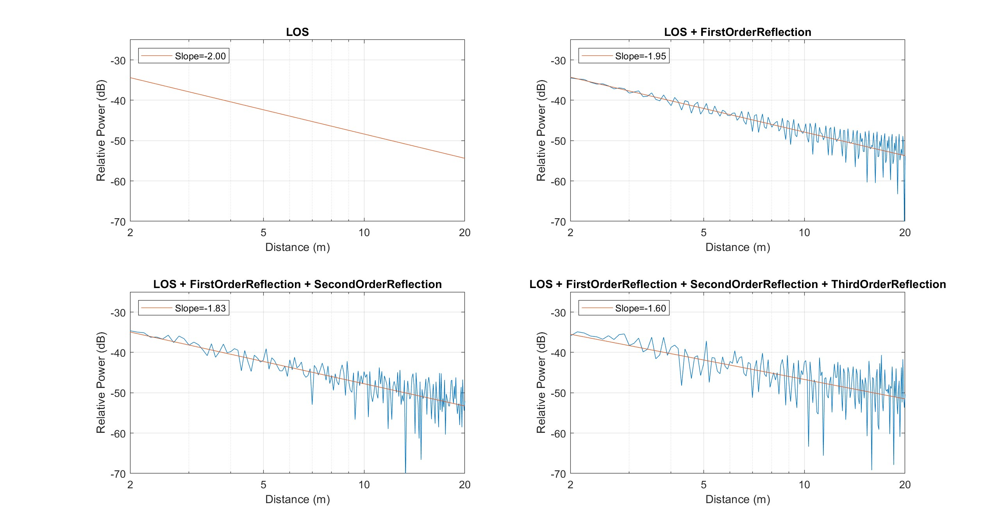
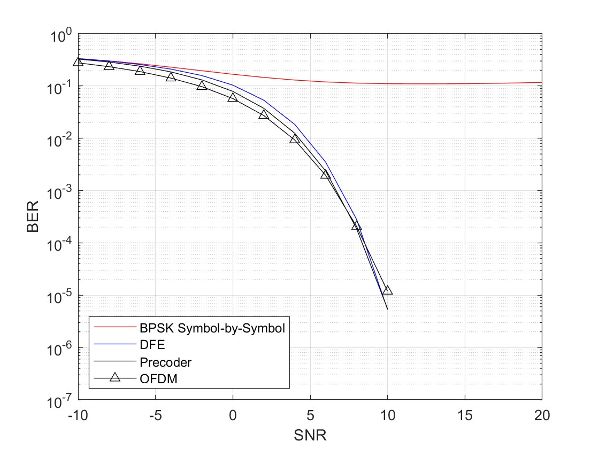
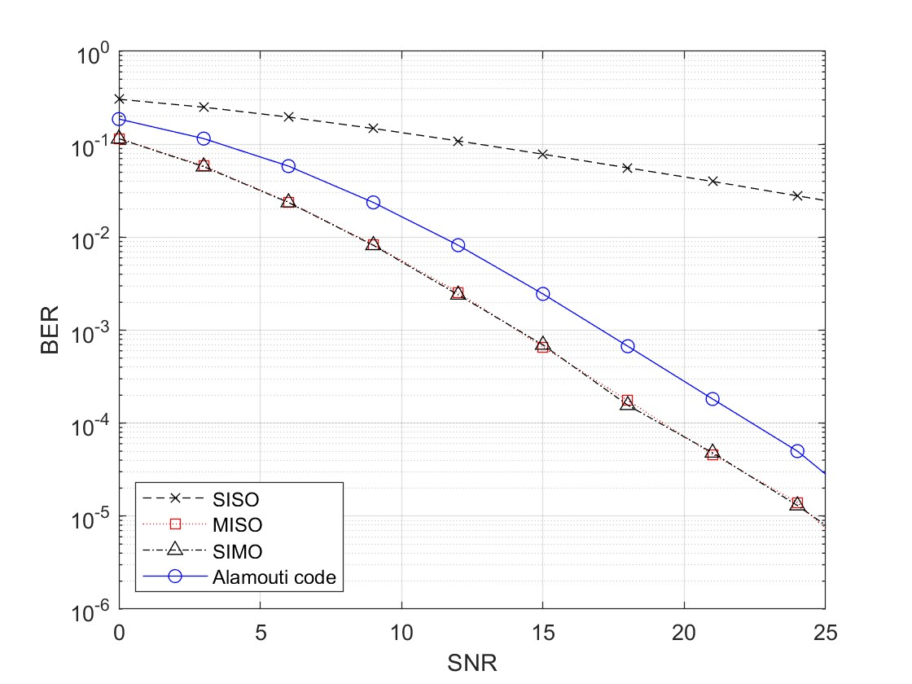
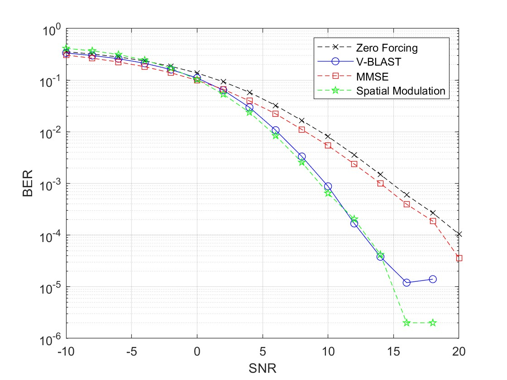
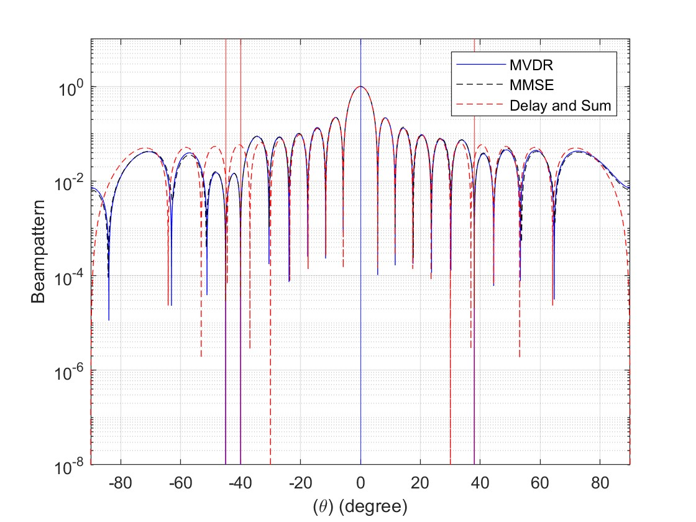
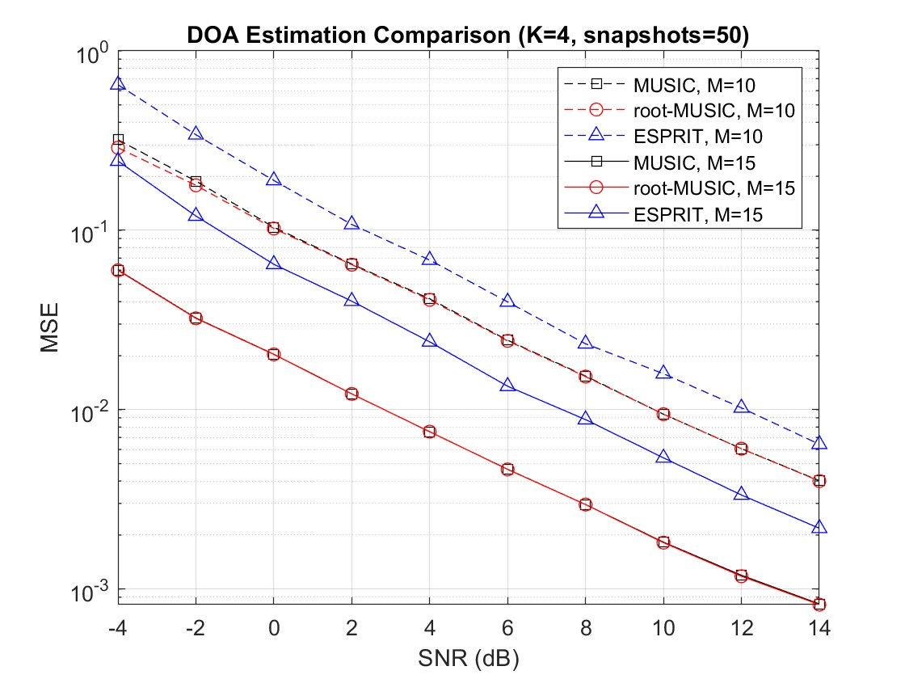
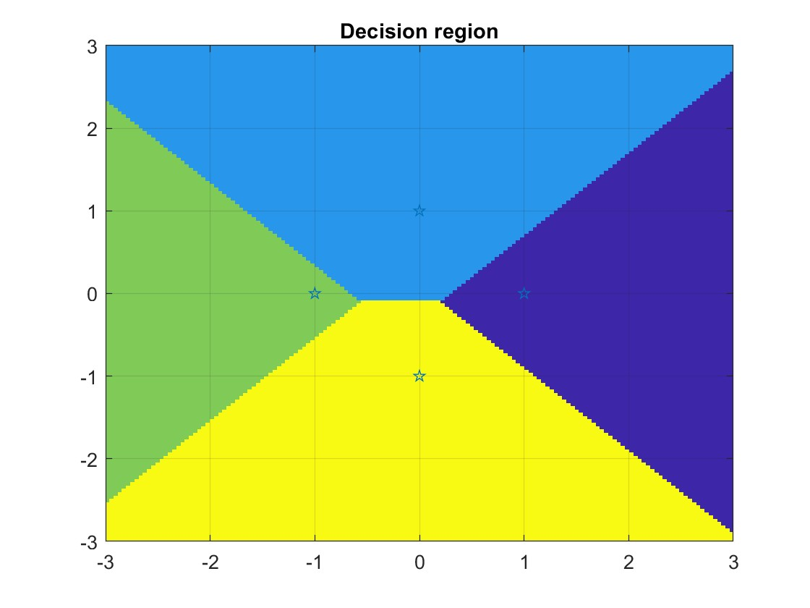
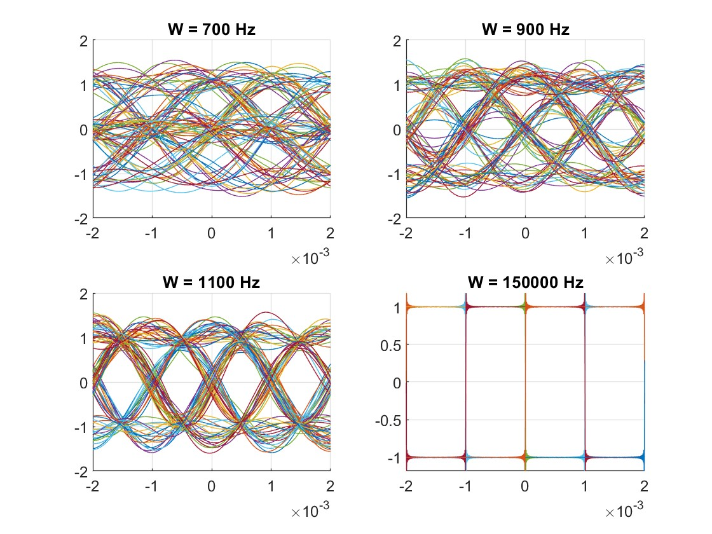
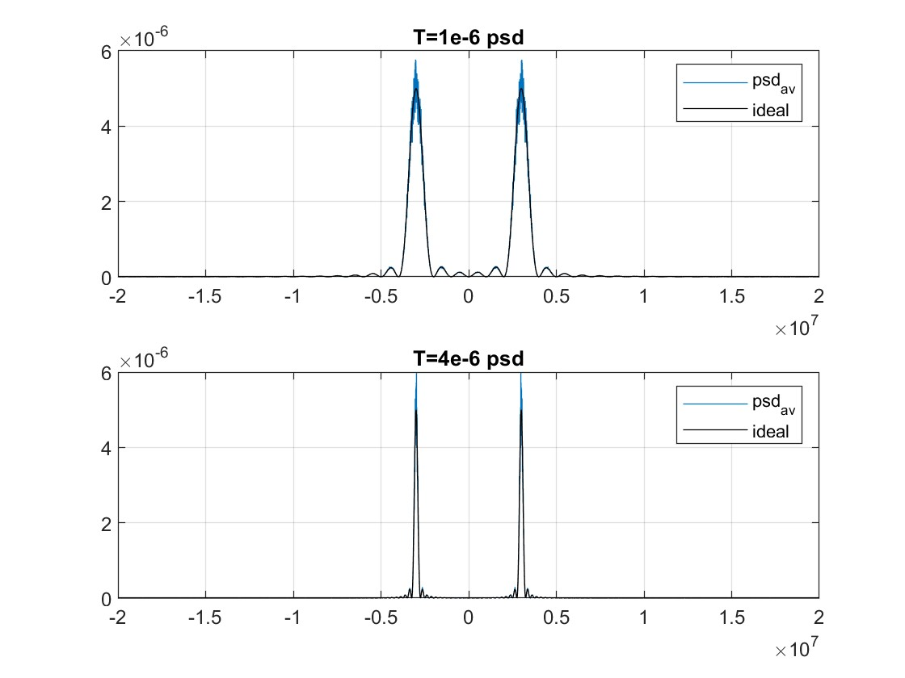

# 通訊系統模擬

修習**行動通訊**、**下世代行動通訊**、**數位通訊**三門課程期間的 MATLAB 模擬練習。

**關鍵字**：Rayleigh / Rician 衰落 · Ray tracing · DFE · OFDM · MIMO（Alamouti、ZF、MMSE、V-BLAST、空間調變）· 波束成形（MVDR / MMSE）· DOA 估計（MUSIC、Root-MUSIC、ESPRIT）· 數位調變（ASK / FSK / PSK / QAM）· Matched filter · BER / SER 理論與模擬比較 · PSD · 眼圖 · FIR / IIR

---

## 課程內容

以下挑選幾個模擬結果用於參考，完整內容見最下方的[逐檔清單](#逐檔清單)。

### 1. 行動通訊 — [`MobileCommunication/`](MobileCommunication/)

#### 衰落通道下的 BPSK

用三種方式產生 Rayleigh fading（`raylrnd`、二路高斯、circular symmetric complex Gaussian），並調整 LOS 權重模擬 Rician 通道，比較 BER。

  
   
  AWGN 的 BER 隨 SNR 指數下降，Rayleigh fading 下只剩約每 10 dB 降一個數量級，三種 Rayleigh 產生方式結果一致；加入 LOS 成分的 Rician 通道落在兩者之間

#### 射線追蹤

50 m × 50 m 室內環境，用 image method 計算 LOS 加上 1～3 次牆面反射的接收功率，再用線性擬合估計路徑損耗斜率。

  
   
  只有 LOS 時斜率為 −2（自由空間路徑損耗）；加入反射後出現多路徑造成的功率起伏，擬合斜率依序變為 −1.95、−1.83、−1.60

### 2. 下世代行動通訊 — [`NexGenMobileCom/`](NexGenMobileCom/)

#### ISI 通道

5-tap ISI 通道下，比較逐符號判決、決策回授等化器（DFE）、傳送端 precoding、OFDM（64 個子載波、CP = 16）的 BER。

  
   
  不處理 ISI 時 BER 卡在 10−1 左右的 error floor；DFE、precoder、OFDM 都能消除 ISI，BER 隨 SNR 正常下降

#### MIMO 分集

比較 SISO、MISO（Tx beamforming）、SIMO（MRC）與 2×2 Alamouti code 在 fading 通道下的 BER。

  
   
  多天線的 BER 斜率明顯比 SISO 陡；Alamouti 不需要傳送端知道通道，代價是和 MISO / SIMO 相比約差 3 dB

#### MIMO 偵測

5×8 空間多工下比較 ZF、MMSE、V-BLAST 與 4×8 空間調變（2 bit 選天線 + 3 bit 8PSK）的 BER。

  
   
  ZF 直接反轉通道，會放大雜訊；MMSE 把雜訊也納入考量，所以略優於 ZF。V-BLAST 每次先解出最可靠的一路，再從接收訊號中扣掉，後面幾路受到的干擾越來越少，在中高 SNR 明顯優於前兩者；空間調變一次只啟用一根天線，沒有天線間干擾，表現與 V-BLAST 相近

#### 接收端波束成形

20 根天線的 ULA，1 個目標訊號加 3 個干擾，比較 Delay-and-Sum、MMSE、MVDR 的波束場型。

  
   
  目標訊號在 0°（藍色直線），3 個干擾在 −45°、−40°、38°（紅色直線）。三種方法對目標方向的增益都是 1；但 MVDR 和 MMSE 會在干擾方向把增益壓到接近 0，Delay-and-Sum 只對準目標方向、不會針對干擾調整，干擾仍會從旁瓣漏進來

#### DOA 估計

用 ULA 估計 4 個訊號源的方向，以同一組資料比較 Standard MUSIC（pseudo-spectrum）、Root-MUSIC（多項式求根）、ESPRIT（rotational invariance）在不同天線數下的 MSE。

  
   
  天線數越多 MSE 越低；MUSIC 與 Root-MUSIC 幾乎重疊，ESPRIT 誤差較大但不需要角度掃描、計算量最小

### 3. 數位通訊 — [`DigitalCommunication/`](DigitalCommunication/)

#### MAP 決策區域

QPSK 在 AWGN 下、四個符號事前機率不相等時，依 MAP rule 計算平面上每一點的判決結果。

  
   
  機率大的符號（上方，13/24）決策區域變大，機率小的符號（左方，1/24）區域被壓縮

#### 眼圖

NRZ 訊號通過不同頻寬 W 的理想低通通道，重疊 100 組隨機序列觀察 ISI。

  
   
  通道頻寬 W 越小，ISI 越嚴重、眼圖越閉合；W 夠大時接近理想方波

#### 功率頻譜密度

16-QAM 用 periodogram 估計 PSD，多次平均後與理論 sinc² 頻譜比較，並比較不同 symbol 時間 T。

  
   
  200 次平均後與理論頻譜吻合，主瓣位於 ±fc = ±3 MHz；T 從 1 μs 拉長到 4 μs，主瓣寬度（2/T）跟著變窄

---

## 執行方式

- **MATLAB**，以及以下 toolbox：
  - Communications Toolbox（`pskmod`、`awgn`、`biterr`、`qfunc`、`bi2de`）
  - Signal Processing Toolbox（`freqz`、`grpdelay`、`findpeaks`、`rectpuls`）
  - Statistics and Machine Learning Toolbox（`raylrnd`、`raylpdf`、`normrnd`）
- 每個 `.m` 都是可以獨立執行的 script，彼此沒有相依，打開後直接 Run 就會畫出結果圖。
- 有些 Monte Carlo 模擬（DOA MSE、MIMO、波束成形 MSE、16-QAM PSD）迴圈次數比較多，執行需要一點時間。
- 每次模擬的資料、雜訊與通道皆為隨機產生，結果曲線會略有差異；高 SNR 區段的錯誤數較少，曲線尾端可能出現起伏。

---

## 逐檔清單

展開所有檔案說明（包含上方沒有列出的練習）

### [MobileCommunication/](MobileCommunication/)

| 檔案 | 說明 |
|---|---|
| [`Rayleigh_Rician_pdf.m`](MobileCommunication/Rayleigh_Rician_pdf.m) | 由二路高斯隨機變數產生 envelope，比較 Rayleigh / Rician 的模擬 histogram 與理論 PDF |
| [`BpskBer.m`](MobileCommunication/BpskBer.m) | BPSK 在 AWGN、Rayleigh（三種寫法）、Rician 下的 BER |
| [`RayTracing.m`](MobileCommunication/RayTracing.m) | 室內射線追蹤，LOS + 1～3 次反射，估計路徑損耗斜率 |

### [NexGenMobileCom/](NexGenMobileCom/)

| 檔案 | 說明 |
|---|---|
| [`conv_filter_1.m`](NexGenMobileCom/conv_filter_1.m) | 訊號與系統複習：弦波通過理想 LPF 的時域摺積與頻域表示 |
| [`conv_filter_2.m`](NexGenMobileCom/conv_filter_2.m) | 訊號與系統複習：三角脈衝通過理想 LPF |
| [`M_PSK_VectorChannel.m`](NexGenMobileCom/M_PSK_VectorChannel.m) | BPSK / QPSK / 8PSK / 16PSK 的 BER（向量通道，用 `pskmod` + `awgn`） |
| [`M_PSK_WaveformChannel.m`](NexGenMobileCom/M_PSK_WaveformChannel.m) | 同上，改用波形通道（passband 波形 + 手刻 correlator） |
| [`precoding.m`](NexGenMobileCom/precoding.m) | ISI 通道：無等化 / DFE / precoder |
| [`ISI_channel.m`](NexGenMobileCom/ISI_channel.m) | 同上，再加上 OFDM |
| [`MIMO.m`](NexGenMobileCom/MIMO.m) | SISO / MISO / SIMO / Alamouti BER |
| [`Spatial_Mod.m`](NexGenMobileCom/Spatial_Mod.m) | ZF / MMSE / V-BLAST / 空間調變 BER |
| [`rx_beamformer_beamPattern.m`](NexGenMobileCom/rx_beamformer_beamPattern.m) | Delay-and-Sum / MMSE / MVDR 波束場型 |
| [`rx_beamformer_MSE.m`](NexGenMobileCom/rx_beamformer_MSE.m) | Delay-and-Sum / MMSE / MVDR 的 MSE vs. SNR |
| [`DOA_standardMUSIC_pseudoSpectrum.m`](NexGenMobileCom/DOA_standardMUSIC_pseudoSpectrum.m) | MUSIC pseudo-spectrum |
| [`DOA_standardMUSIC_MSE.m`](NexGenMobileCom/DOA_standardMUSIC_MSE.m) | MUSIC 的 MSE vs. SNR（M = 10、15、20） |
| [`DOA_rootMUSIC_root.m`](NexGenMobileCom/DOA_rootMUSIC_root.m) | Root-MUSIC 的根在複數平面上的分布 |
| [`DOA_rootMUSIC_MSE.m`](NexGenMobileCom/DOA_rootMUSIC_MSE.m) | Root-MUSIC 的 MSE vs. SNR（M = 10、15） |
| [`ESPRIT.m`](NexGenMobileCom/ESPRIT.m) | ESPRIT 單次估計 |
| [`ESPRIT_MSE.m`](NexGenMobileCom/ESPRIT_MSE.m) | ESPRIT 的 MSE vs. SNR（M = 10、15） |
| [`DOA_compare_MSE.m`](NexGenMobileCom/DOA_compare_MSE.m) | MUSIC / Root-MUSIC / ESPRIT 用同一組資料比較 MSE vs. SNR（M = 10、15） |

### [DigitalCommunication/](DigitalCommunication/)

| 檔案 | 說明 |
|---|---|
| [`ASKFSK_wave.m`](DigitalCommunication/ASKFSK_wave.m) | ASK、FSK 的 bit stream 與調變波形 |
| [`QAM_8_wave.m`](DigitalCommunication/QAM_8_wave.m) | 8-QAM 調變波形 |
| [`ASK_error.m`](DigitalCommunication/ASK_error.m) | ASK 經 matched filter 解調，在 bit 結束處取樣判決；比較兩種 Tb 下的模擬 BER 與理論 Q 函數 |
| [`FSK_error.m`](DigitalCommunication/FSK_error.m) | FSK 經 matched filter 解調；比較兩種 Tb 下的模擬 BER 與理論 Q 函數 |
| [`integrate_dump_receiver.m`](DigitalCommunication/integrate_dump_receiver.m) | Integrate and dump receiver，用 105 個 bit 模擬 antipodal 訊號，觀察 BER 隨 N0、振幅、Tb 的變化 |
| [`QPSK_error.m`](DigitalCommunication/QPSK_error.m) | QPSK：passband 波形 → correlator 取得 I/Q → 內積判決，SER 與理論比較 |
| [`QAM_16_error.m`](DigitalCommunication/QAM_16_error.m) | 16-QAM：passband 波形 → correlator 取得 I/Q → 最小距離判決，SER 與理論比較 |
| [`MPSK_constellation.m`](DigitalCommunication/MPSK_constellation.m) | 8-PSK 在 AWGN 下的星座圖（改 `M` 可換成其他階數） |
| [`QAM_16_constellation.m`](DigitalCommunication/QAM_16_constellation.m) | 16-QAM 在 AWGN 下的星座圖 |
| [`QPSK_decision_region.m`](DigitalCommunication/QPSK_decision_region.m) | QPSK 的 MAP 決策區域（程式內含等機率與不等機率兩組事前機率，目前畫的是不等機率） |
| [`QAM_16_psd_Rtau.m`](DigitalCommunication/QAM_16_psd_Rtau.m) | 16-QAM PSD：先算自相關再做 FFT，與理論比較 |
| [`QAM_16_psd_Sf.m`](DigitalCommunication/QAM_16_psd_Sf.m) | 16-QAM PSD：periodogram 平均，與理論比較 |
| [`eye_pattern.m`](DigitalCommunication/eye_pattern.m) | 不同通道頻寬下的眼圖 |
| [`DSP_filterdesign_FIR.m`](DigitalCommunication/DSP_filterdesign_FIR.m) | 用 `filterDesigner` 設計的 FIR 濾波器，畫出振幅響應與 group delay，並印出 H(z) |
| [`DSP_filterdesign_IIR.m`](DigitalCommunication/DSP_filterdesign_IIR.m) | 用 `filterDesigner` 設計的 IIR 濾波器，畫出振幅響應與 group delay，並印出 H(z) |

---

## 作者

- 張茲逸｜長庚大學 電機工程學系
